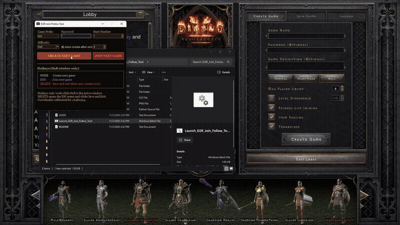
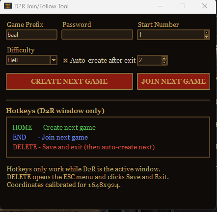

# D2R Join/Follow Tool

A small Windows helper for Diablo II: Resurrected that creates and joins numbered games (like `baal-1`, `baal-2`, ...) with one hotkey.

## Download
Download **D2R_Join_Follow_Tool.exe** from the [latest release](https://github.com/scorchmuff1n/D2R-Join-Follow-Tool/releases/latest) and run it. It's a single file and needs no Python install. (Windows SmartScreen may warn since it's unsigned; click More info > Run anyway.)

The original zip is still available on the release page.

## Features
- Set a game prefix, password, start number and difficulty
- **Create Next Game** / **Join Next Game** buttons
- Auto-create the next game after you exit, with a short delay you can set

## Hotkeys (only while D2R is the active window)
| Key | Action |
|-----|--------|
| `HOME` | Create next game |
| `END` | Join next game |
| `DELETE` | Save and exit (opens the ESC menu and clicks Save and Exit), then auto-create the next game |

## Notes
- Click positions are calibrated for a 1648x924 game window.

## Running from source
Requires Python 3 on Windows and the `pyautogui` package (the launcher installs it for you if it is missing). Run `Launch_D2R_Join_Follow_Tool.bat` or `python D2R_Join_Follow_Tool.py`.

## License
MIT, see [LICENSE](LICENSE).

## Disclaimer
Fan-made tool, not affiliated with Blizzard Entertainment. Use at your own risk.
